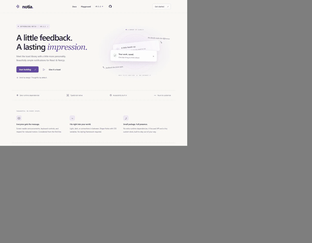

# Notia

**Small notifications. Clear feedback.**

Expressive, accessible toast notifications for React and Next.js. Available on npm as [`notia`](https://www.npmjs.com/package/notia).

Source for the **0.2.0** release, including interactive notifications and the documentation website.



## Why Notia?

- Success, error, info, warning, loading, and promise notifications.
- Six positions with light, dark, and system themes.
- Keyboard dismissal, screen reader announcements, swipe dismissal, and reduced-motion support.
- Timers pause on hover, focus, window blur, and hidden tabs.
- Bounded queues and stable IDs for updates and duplicate prevention.
- TypeScript declarations, ESM/CJS builds, and no additional runtime dependencies.
- Supports React 18.3 and React 19, including Next.js App and Pages Routers.

## Interactive notifications

- Action and cancel buttons with async pending states, duplicate-click protection, and recoverable errors.
- Persistent progress notifications with accessible percentage values.
- Per-type and per-toast custom icons, including an icon-free option.
- Optional expandable stacks with keyboard/touch controls and paused hidden timers.
- RTL layout and translatable notification controls.

Try these additions in the local playground. Existing notification methods and default layouts remain compatible. See the [package API](packages/echo/README.md#new-in-020) for examples. Nothing is published by building or testing the project.

## Install

```sh
npm install notia
```

React and ReactDOM are peer dependencies. Import the stylesheet once and mount one Toaster near your application root.

## Quick start

```tsx
'use client';

import { notia, Toaster } from 'notia';
import 'notia/styles.css';

export default function App() {
  return (
    <>
      <button onClick={() => notia.success('Your work, saved.')}>
        Save changes
      </button>
      <Toaster position="bottom-right" theme="system" />
    </>
  );
}
```

For Next.js, mount `<Toaster />` and import the stylesheet in your root layout or `pages/_app.tsx`. Call `notia` from client components, event handlers, or browser utilities.

## A small API

```tsx
notia.success('Saved', { description: 'Your changes are up to date.' });
notia.error('Could not save');
notia.info('An update is available');
notia.warning('You have unsaved changes');

const id = notia.loading('Uploading…');
notia.update(id, { type: 'success', message: 'Uploaded' });
notia.dismiss(id);
notia.dismissAll();
```

Pass an explicit `id` to update an existing notification instead of creating a duplicate. Use `duration: Infinity` for messages that should stay visible until dismissed.

### Follow a promise

```tsx
try {
  const result = await notia.promise(saveWork(), {
    loading: 'Saving…',
    success: 'Your work, saved.',
    error: 'Could not save. Try again.',
  });
  // Use result here.
} catch (error) {
  // Handle the original failure in your application.
}
```

One toast follows loading, success, and failure. The returned promise preserves the original result or rejection.

See the [full API documentation](packages/echo/README.md) for options, custom content, themes, and Next.js examples.

## Website

The website includes a home page, a focused playground, and separate documentation pages:

| Route                 | Content                                      |
| --------------------- | -------------------------------------------- |
| `/`                   | Introduction and features                    |
| `/playground`         | Interactive toast controls and code examples |
| `/docs`               | Installation and setup                       |
| `/docs/api`           | Methods and options                          |
| `/docs/styling`       | Themes and custom styles                     |
| `/docs/accessibility` | Accessible usage                             |
| `/docs/releases`      | Release notes                                |

### Run locally

Use Node.js 22.14+ within 22.x, Node.js 24, or Node.js 26+, and pnpm 10.30.3. From the repository root:

```sh
pnpm install --frozen-lockfile
pnpm build:lib
pnpm dev
```

Open [localhost:3000](http://127.0.0.1:3000). For a production build, run `pnpm run build` from the repository root. Vercel setup is documented in [the deployment guide](docs/deploying.md).

## Verification

Run from the repository root:

```sh
pnpm exec playwright install chromium firefox webkit
pnpm run verify
```

The verification gate audits dependencies, builds the library and website, checks coverage, types, lint, formatting, release tooling, and packed package contents. It also tests isolated React 18/19, Vite, and Next.js consumers, then runs browser and accessibility checks against a fresh production server on port 3100.

Individual checks include `pnpm test:coverage`, `pnpm typecheck`, `pnpm lint`, `pnpm check:package`, `pnpm test:compat`, and `pnpm test:e2e`.

See [CONTRIBUTING.md](CONTRIBUTING.md) for individual checks, report locations, and testing limitations. Automated accessibility checks do not replace testing with assistive technology in your application.

## Contributing and releases

See [CONTRIBUTING.md](CONTRIBUTING.md) for setup, bug reports, testing, and pull requests. The [architecture guide](docs/architecture.md) explains implementation decisions.

Maintainers can follow the [release guide](docs/releasing.md) for Changesets, verification, npm publication, and Git tags. Publishing automatically runs the verification gate.

## License

[MIT](LICENSE) © 2026 Sravan Saiba.
