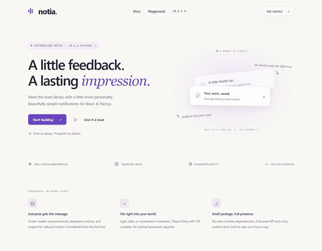

# Notia

**Small notifications. Clear feedback.** Expressive, accessible toast notifications for React and Next.js.

Package prepared: `notia@0.1.1`. The original `@sravan_saiba/echo@0.1.0` is published. The new name is not published yet, and the documentation is local until deployed.



- [Package API and migration guide](packages/echo/README.md)
- [Product plan](ECHO_PLAN.md)
- [Release checklist](RELEASE.md)
- [Publish Notia yourself](PUBLISHING.md)
- [Deploy the website to Vercel](DEPLOYING.md)
- [Verification results](VERIFICATION.md)
- [Design decisions](DESIGN.md)

## Work locally

Use Node 22.14+ (22.x), Node 24, or Node 26+, and pnpm 10.30.3.

```sh
pnpm install
pnpm build:lib
pnpm dev
```

The website has real routes with a shared header:

- `/` — introduction, features, and quick links.
- `/playground` — a focused interactive workspace.
- `/docs` — installation and migration.
- `/docs/api` — methods and options.
- `/docs/styling` — CSS variables and themes.
- `/docs/accessibility` — accessible usage.
- `/docs/releases` — package status and release notes.

The development site runs at http://127.0.0.1:3000. The Pages Router compatibility fixture remains at `/compatibility`.

## Verify

```sh
pnpm exec playwright install chromium firefox webkit
pnpm verify
```

Verification audits dependencies, builds the package and site, checks coverage/types/lint/formatting, validates release tools and package contents, installs the tarball into isolated consumers, and runs browser/accessibility tests. Tests start a fresh production server on port 3100 and never reuse the development server.

Individual checks: `pnpm test:coverage`, `pnpm typecheck`, `pnpm lint`, `pnpm check:package`, `pnpm test:compat`, and `pnpm test:e2e`.

## Package naming and compatibility

After publication, new users install `notia` and import `{ notia, Toaster }`. The `echo` export remains an alias, and existing `--echo-*` CSS variables and `.echo-*` classes remain compatible. The workspace directory `packages/echo` stays in place; the npm package name is independent of that folder name.

Notia is an invented name inspired by notifications. It has no claimed Japanese etymology. Nothing was published under any of the provisional alternative names discussed during naming.

## Releases

Use `pnpm changeset` and `pnpm version-packages` for future release notes and version updates. Publishing runs verification through prepublishOnly. The GitHub release workflow is manual and requires the npm environment and publishing credentials. Hosted CI and public documentation hosting are separate from local verification and npm publication.
